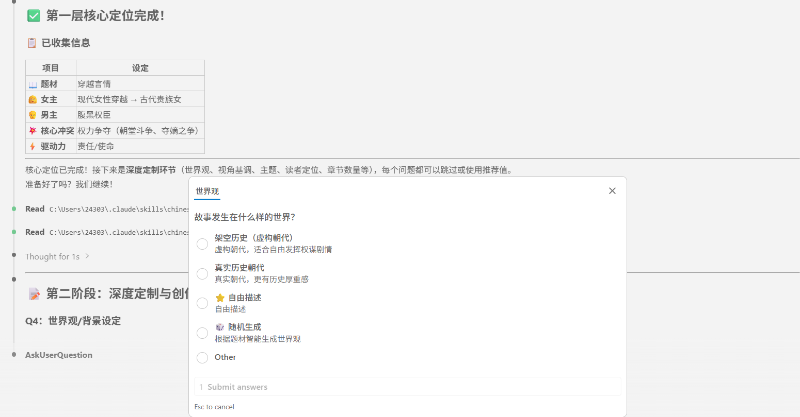

<div align="center">

# chinese-novelist skill

### 让 AI 为你写一部完整的中文小说

[](https://github.com/PenglongHuang/chinese-novelist-skill/releases)
[](https://claude.com/claude-code)
[](LICENSE)

> **v2.0 重构发布**：引入三层递进式问答、偏好记忆系统、中断续写、三种写作模式和自动校验修复！
>
> 查看 [v1.0 → v2.0 升级说明](https://github.com/PenglongHuang/chinese-novelist-skill/pull/10) 了解详情。

</div>


## 为什么用这个？

写小说最难的是**坚持写完**。这个 Skill 专为解决这个痛点而生：

- **双架构支持** - 标准轻量架构（短篇快速）与深度史诗架构（9级工程目录、独立人物主档、JIT加载、动态事实账本）
- **三级分类人物小传体系与写前拦截** - 核心铁律：**主角和配角都要有人物小传，理论上只要多次出现的人物都要设立小传！**明确冰山原则：小传没必要所有的情节都在正文中提及，只是为性格和人物建立基础，后续合规性校验（教研质检）时当做基准输入。小传按「主角、配角、辅助角色+章节」归类，辅助角色以首次登场章节命名（如 `第001章-边民老猎户.md`），写前盘点缺档即时补齐，后续秒查复用防崩坏
- **多媒体资源自由扩展（人物插画与剧情音频）** - 原生内置「人物插画」与「剧情音频」专属目录（深度模式为 `10-人物插画/` 与 `11-剧情音频/`，标准模式为 `人物插画/` 与 `剧情音频/`）。用户可完全根据个人喜好与节奏，自由添加角色立绘/肖像插画与关键剧情配音朗读/氛围配乐（BGM），并在小传或正文中按需引用，未提供不影响全自动创作流程
- **三大防跑偏工程规则** - 唯一权威源（SSOT）、渐进式按需读取、写后事实回写，彻底杜绝长篇设定崩塌
- **四维单章硬质检闸口** - 每章结束执行时间轴时空、主角年龄吻合度、情节合理性与伤病继承、人设防崩与负面禁令硬性核验
- **Nuwa 双源动态加权文风演进与标杆矩阵** - 基于 `alchaincyf/nuwa-skill` 蒸馏心智模型与表达 DNA。创新引入**双源动态加权文风演进机制**：文风不仅参考提供的外部文本，更深度参考小说自身的正文部分；且**小说正文越多，参考自身的权重越重**（从起步期的外部主导 85%:15%，平滑演进至成熟期的自身主导 90%:10%），写前双源注意力锚定，写后持续沉淀高光段落。原生集成军旅/硬核三大标杆：《士兵突击》（重人物关系变化而非军事术语）、《我的团长我的团》（不完美军人与苦中作乐，控台词密度杜绝全员哲学家）、《第一序列》（危险与日常一张一弛交替、生活幽默感、去无代价光环）
- **去 AI 味四关制（四个外部 skill 逐章全过）** - 每章写完依次过 `Humanizer-zh`（抬高与套式）、`speak-human-tw`（空转与腔调）、`说人话 shuorenhua`（翻译腔与公文腔）、`lieflat-less-ai-tone`（结构与节奏套式）。四关已按长篇小说的文体本地化（台词豁免、侦察辨识式「不是A而是B」保留、不引入台湾用词层、白名单外一字不改），任一关 BLOCKED 不得进入事实回写；`scripts/scan_ai_tone.py` 负责机械合检并自动落盘 `08-审稿/第{XX}章-去AI味四关报告.md`。规则与执行卡见 `references/ai-tone/`
- **智能问答** - 三层递进式问答，支持快速跳过和随机生成
- **偏好记忆** - 跨会话学习你的喜好，下次创作更贴心
- **中断续写** - 意外中断？自动检测并从断点继续
- **多种写作模式** - 串行 / 子Agent并行 / Agent Teams，按需选择
- **自动校验** - 完成后自动检查字数和连贯性，不合格自动重写
- **每章必爽** - 开头即高潮，结尾留悬念

## 快速开始

安装skill：`npx skills add PenglongHuang/chinese-novelist-skill`

输入指令：`使用 chinese-novelist 帮我写一部小说`

## 赞助商

<p align="center">
  <a href="https://www.infistar.cc/register?aff=29SS8B9E&ref_source=link">
    
  </a>
</p>

**chinese-novelist-skill × [Infistar.cc](https://www.infistar.cc/register?aff=29SS8B9E&ref_source=link)**

用这个技能包写长篇的朋友都知道：动辄几十万字的大纲回溯、多代理并行出章，额度往往比灵感先耗尽。

如果想放开手脚写长篇，推荐换上 Infistar：

- **零配置接入**：无需修改代码，Claude Code / 客户端只需换上 Base URL 与 Key 即可开工。
- **超低成本试错**：多模型价格极具优势。整卷重构、换文风重写、多代理并行爆肝不再肉疼。
- **全模型任意切**：Claude、GPT、Gemini、DeepSeek 一个 Key 全搞定，改个模型名就能对比打斗与感情戏表现。
- **国内顺畅使用**：RMB 直接结算，全模型支持验真防掺水。
- **专属福利**：通过[专属通道](https://www.infistar.cc/register?aff=29SS8B9E&ref_source=link)注册即送 $5 体验额度。建议领完拿同一份大纲让两个模型各试跑 3 章，感受文笔差异！

---

## 使用过程

<table>
  <tr>
    <td align="center"><b>Phase 1 — 交互问答</b></td>
    <td align="center"><b>Phase 2 — 规划确认</b></td>
  </tr>
  <tr>
    <td></td>
    <td></td>
  </tr>
  <tr>
    <td align="center"><b>Phase 3 — 疯狂创作</b></td>
    <td align="center"><b>Phase 4 — 完稿输出</b></td>
  </tr>
  <tr>
    <td></td>
    <td></td>
  </tr>
</table>


## 创作记忆

每次创作后，Skill 会自动学习你的偏好：喜欢的题材类型、叙事风格、章节数量倾向、文字密度等。下次使用时，直接应用你的习惯，省去重复问答。

<p align="center">
  
</p>


## 创作流程

```
用户 → ┌─────────────┐    ┌──────────────────────┐    ┌──────────────┐
       │ Phase 0     │ →  │ Phase 1              │ →  │ Phase 2      │
       │ 初始化      │    │ 三层递进式问答        │    │ 规划 + 确认  │
       │ ·加载偏好   │    │ L1: 核心定位 (必答)   │    │ ·大纲        │
       │ ·检测中断   │    │ L2: 深度定制 (可选)   │    │ ·人物分级小传│
       └─────────────┘    └──────────────────────┘    │ ·写作计划JSON│
                                                      └──────┬───────┘
                                                             ↓
                                             ┌───────────────────────────┐
                                             │ Phase 2.5 写作模式选择     │
                                             │ 串行 / 子Agent并行 / Teams │
                                             └─────────┬─────────────────┘
                                                       ↓
       ┌──────────────────────────────────────────────────────────────┐
       │ Phase 3 疯狂创作（全自动，无需确认）                         │
       │ 逐章：写前角色盘点与补齐 → 撰写(3000-5000字) → 四关去AI味   │
       │       → 四维一致性质检拦截 → 事实回写与更新摘要              │
       └──────────────────────────────────────────────────────────────┘
                            ↓
       ┌──────────────────────────────────────────────────────────────┐
       │ Phase 4 自动校验与修复（全自动）                             │
       │ 字数检查 → 四关复跑 → 连贯性检查 → 不合格重写（最多3轮）     │
       └──────────────────────────────────────────────────────────────┘
                            ↓
                       全稿完成
```

### Phase 0：初始化

自动加载用户偏好（`user-preferences.json`），检测是否有未完成的项目可续写，展示个性化欢迎。

### Phase 1：三层递进式问答

**Layer 1 — 核心定位（必答，3问）**：题材创意、主角设定、核心冲突

**Layer 2 — 深度定制（可选，5问）**：世界观、叙事视角、核心主题、读者定位、章节数量

> 每个问题都支持随机生成，也可以直接说"跳过"或"都用默认"。

```
Q1：题材与创意
   ○ 悬疑推理   ○ 现代言情   ○ 奇幻玄幻   ○ 科幻未来
   ○ 武侠仙侠   ○ 历史架空   ○ 都市现实   ○ 随机生成

Q2：主角设定
   ○ 男性主角   ○ 女性主角   ○ 双主角     ○ 群像戏

Q3：核心冲突
   ○ 生死存亡   ○ 查明真相   ○ 复仇雪恨   ○ 成长突破
   ○ 爱情阻碍   ○ 权力争夺   ○ 守护保护

   ... Layer 2 可继续定制，也可直接跳到规划 ...
```

### Phase 2：规划 + 确认

AI 自动生成大纲（7列章节规划）、三级分类人物档案（主角/配角/辅助角色+章节）、写作计划 JSON，展示给你确认：

```
━━━━━━━━━━━━━━━━━━━━━━━━━━━━━━━━━━
规划完成！请确认：

基本信息
  题材：科幻军事  |  主角：陈渡（老渡）  |  冲突：守护破局
  章节数：20章    |  视角：第三人称限制  |  基调：硬核冷峻

章节规划（前5章）
  第001章：寒风七折岩 - 破晓换岗，发现专业特战队灭口的老猎户尸体...
  第002章：断链之讯 - 远距侦察蜂鸟遭干扰，全频段杂波压制...
  ...

主要人物
  主角：陈渡 - 队长兼任强攻手，老兵沉稳，【地脉微颤】
  核心配角：林霰 - 精确射手，爽朗脆快，暗藏隐秘禀赋
  核心配角：霍山 - 老机械师兼救护，嘴硬心软
  辅助角色（第001章）：边民老猎户 - 遭军规特战队灭口，引出残片线索

━━━━━━━━━━━━━━━━━━━━━━━━━━━━━━━━━━
回复"确认" → 选择写作模式 → 立即开始
```

### Phase 2.5：写作模式选择

| 模式 | 说明 | 适用场景 |
|------|------|----------|
| **串行** | 主 Agent 逐章写，稳定可靠 | 默认推荐 |
| **子Agent并行** | 多个子 Agent 分批并行写 | 追求速度 |
| **Agent Teams** | Claude Code 多 Agent 协作 | 大型长篇 |

### Phase 3：疯狂创作

确认后进入全自动创作模式，无需再次确认。你可以离开工作台，等待完成。

每章严格执行：
1. **写前角色盘点与小传补齐（硬性前置）**：对照任务卡盘点参演人员，核查哪些人缺少小传。**核心原则：理论上只要不是纯一次性龙套，都必须在动笔前补全小传！**（主角单列，配角/辅助角色还须按首次正式登场时的所属势力归档；插章主视角与关键人物同样必须建小传）
2. **正文撰写**：达到 3000-5000 字硬指标，人设负面禁令与动态生理状态硬约束。
3. **去 AI 味四关（全过，硬性前置）**：`scan_ai_tone.py` 机检落盘 → G1 Humanizer-zh → G2 speak-human-tw → G3 说人话 shuorenhua → G4 lieflat-less-ai-tone → 重跑至 block=0。任一关 BLOCKED 不得进入下一步。
4. **四维一致性硬核验**：时间轴时空、主角年龄吻合度、情节合理性与伤病继承、人设防崩。未通过严禁标记完成。
5. **事实回写与更新摘要**：回写人物实时状态、时间线与伏笔记录。

```
第1章完成（3620字）
第2章完成（3582字）
第3章完成（3412字）
...
```

### Phase 4：自动校验

全稿完成后自动检查：字数达标、连贯性通过，不合格章节自动重写（最多3轮）。

---

## 输出样例

### 深度模块化架构（Deep Mode）

```
chinese-novelist/
├── user-preferences.json              # 用户偏好（跨项目共享）
└── 20261025-150000-崖边戍卒/
    ├── AGENTS.md                      # 全局创作约束与 JIT 加载指南
    ├── 00-人物档案.md                  # 从 02-人物/ 提取编译的只读速查表
    ├── 01-大纲.md                      # 全书主线与分卷剧情索引
    ├── 02-写作计划.json                # 机器可读进度调度核心
    ├── 03-文风基准.md                  # 文风指纹与基准段落锚点
    ├── 99-章节摘要.md                  # 逐章摘要汇总
    ├── 01-世界观/                      # 8 大专题文档（历史、地理、阵营、战力、科技等）
    ├── 02-人物/                        # 三级人物档案唯一权威源
    │   ├── 人物总表.md                 # 主角/配角/辅助角色矩阵索引
    │   ├── 人物关系与冲突.md           # 团队内部关系与外部博弈矩阵
    │   ├── 主角/                       # 主角独立主档（十维设定与禁令）
    │   │   └── 陈渡.md
    │   ├── 配角/                       # 核心配角，继续按初始所属势力分子文件夹
    │   │   ├── 林霰.md
    │   │   └── 霍山.md
    │   └── 辅助角色/                   # 初始势力/第XXX章-角色名.md 或 第一卷插章NNN-角色名.md
    │       ├── 第001章-边民老猎户.md
    │       └── 第002章-白汀联络哨长.md
    ├── 03-剧情/                        # 全书主线、分卷因果三问大纲、伏笔管理
    ├── 04-文风/                        # 文风总规范、文风DNA蒸馏、原创样章
    ├── 05-写作计划/                    # 章节规划总表与单章任务卡
    ├── 06-正文/                        # 正式分卷章节正文
    ├── 07-创作记忆/                    # 动态事实账本（人物实时状态、时间轴总账、事实日志）
    ├── 08-审稿/                        # 单章多维质检报告
    ├── 09-归档/
    ├── 10-人物插画/                    # 角色视觉立绘、肖像与高光插画（用户自主扩展）
    └── 11-剧情音频/                    # 章节配音朗读与BGM氛围音频（用户自主扩展）
```

### 标准轻量架构（Standard Mode）

```
chinese-novelist/
├── user-preferences.json              # 用户偏好（跨项目共享）
└── 20260412-143000-午夜列车/
    ├── 01-大纲.md                      # 故事概述、章节规划（7列模板）+ 设定词典
    ├── 00-人物档案.md                  # 主角、配角、辅助角色（按章节归类）档案
    ├── 02-写作计划.json                # 机器可读的写作计划（v2）
    ├── 03-文风基准.md                  # 文风指纹、基准段落、AI味负面清单
    ├── 99-章节摘要.md                  # 逐章摘要（连贯性参考，随进度追加）
    ├── 人物插画/                      # 角色立绘与肖像插画库（用户按需存放）
    ├── 剧情音频/                      # 剧情配音与配乐音频库（用户按需存放）
    ├── 第01章-最后一班列车.md
    ├── 第02章-消失的乘客.md
    └── ...
```

---

## 核心法则

| 法则 | 说明 |
|-----|------|
| **展示而非讲述** | 用动作和对话表现，不要直接陈述 |
| **冲突驱动剧情** | 每章必须有冲突或转折 |
| **悬念承上启下** | 每章结尾必须留下钩子 |
| **开头即高潮** | 前 20% 必须极其吸引人 |
| **全员小传与多次登场必立传** | 主角/配角与多次登场角色必立小传；小传奠定性格基石（无需正文全盘复述情节），后续合规性教研质检时作为输入 |

---

## 安装

将此目录放入 Claude Code 的 skills 目录：

```
~/.claude/skills/chinese-novelist/
```

或通过 Claude Code 技能管理界面安装。

---

## 内置参考资料

### 流程文档（`references/flows/`）

| 文件 | 内容 |
|------|------|
| `phase0-initialization.md` | Phase 0：初始化与偏好加载 |
| `phase1-layer1-core.md` | Phase 1 Layer 1：核心定位问答（Q1-Q3） |
| `phase1-layer2-customize.md` | Phase 1 Layer 2：深度定制问答 |
| `phase2-planning.md` | Phase 2：规划与三级人物架构生成 |
| `phase3-writing.md` | Phase 3：疯狂创作（写前角色盘点与三大写作模式） |
| `chapter-checklist.md` | 逐章创作清单（唯一事实源，含写前小传拦截与四维质检） |
| `phase4-validation.md` | Phase 4：自动校验与修复 |
| `shared-infrastructure.md` | 共享机制（偏好系统、黄金法则、字数与记忆同步脚本） |

### 写作指南（`references/guides/`）

| 文件 | 内容 |
|------|------|
| `chapter-guide.md` | 章节写作指南（含开头技巧、中文文学技法、连贯性保证、质量检查） |
| `hook-techniques.md` | 悬念设置技巧（13 种结尾钩子类型） |
| `character-building.md` | 人物塑造技法（含长篇人物层级管理：主角/配角/辅助角色+章节规范） |
| `deep-character-template.md` | 深度人物档案模板（十维主档模板 + 辅助角色精悍小传模板） |
| `character-template.md` | 标准人物档案模板（主角/配角/辅助角色+章节） |
| `dialogue-writing.md` | 对话写作规范（含节奏进阶、权力博弈） |
| `plot-structures.md` | 情节结构模板 |
| `content-expansion.md` | 内容扩充技巧（含分题材策略、实例对比） |
| `outline-template.md` | 大纲模板（7列章节规划） |
| `chapter-template.md` | 章节文件模板 |

---

## 版本与路线

- **更新日志**：[Releases](https://github.com/PenglongHuang/chinese-novelist-skill/releases) — 每个版本的完整变更
- **Roadmap**：[ROADMAP.md](ROADMAP.md) — 已完成 / 进行中 / 计划中

---

## 交流

- [GitHub Discussions](https://github.com/PenglongHuang/chinese-novelist-skill/discussions) — 使用心得、作品分享、功能想法
- [Issues](https://github.com/PenglongHuang/chinese-novelist-skill/issues) — 问题反馈与 bug 报告

## 赞助

如果这个项目帮你写出了第一部小说，可以考虑[在爱发电赞助我](https://afdian.com/a/penglonghuang)，你的支持直接决定项目的更新速度。

## 许可

[MIT](LICENSE)
