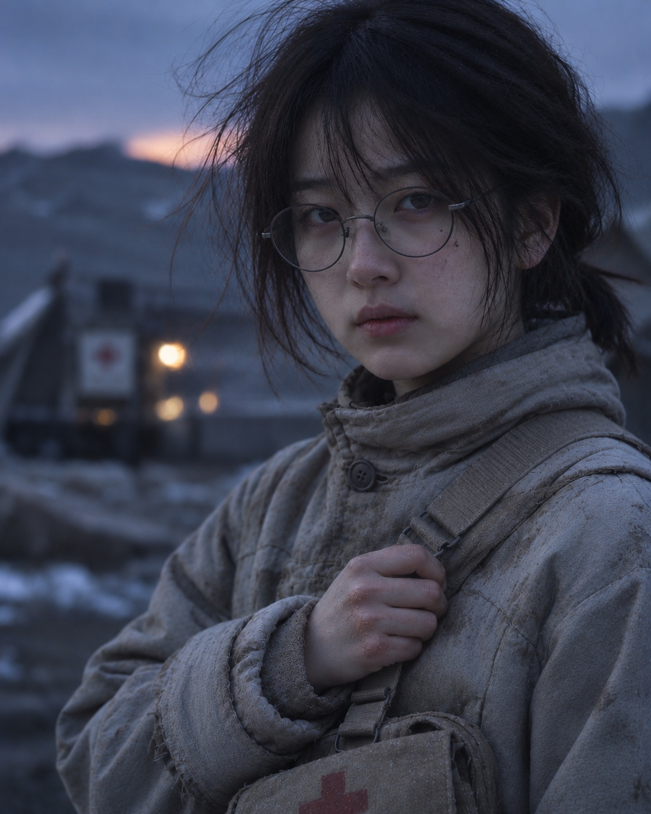

# 人物档案：江小年（代号：缝针）

最后修订时间：2026-11-28 11:35:00 +08:00

## 角色图

> 本图为角色视觉参考，涉及年龄、装备及剧情事实时，以人物主档文字设定为准。

## 索引速查字段（摘要）
- **所属阵营/身份**：白汀基层战地救护员，第二卷加入青隘断崖小队；旧身份隐秘
- **显性性格**：温和怯生、细致坚韧；对分诊与救人有独立底线
- **能力特长**：止血、固定、创面护理与战伤分诊；第五卷起学习远距离观测与情报记录，依赖普通训练和光学器材而非第二项超感；不具独立复杂手术或专业狙击能力

## 1. 基础信息
- **姓名/代号**：江小年（原名：**江楠**） / 战术代号“缝针”、“小年”
- **性别**：**女**
- **首次登场**：第021章矿洞救护点与陈渡等相遇，第031章选择加入断崖小队
- **角色定位**：主角（断崖小队群像核心主角 / 战地救护员 / 队伍的冷静担当）
- **生理年龄/外观年龄**：24 岁 / 身形单薄瘦弱，瓜子脸，皮肤白皙却总带着一丝病态的苍白；眼神柔和胆怯如荒原惊鹿，说话细声细气
- **出身背景**：**白汀中立戍区本地人**。本名江楠，原为白汀药材商贾之女；公元 2136 年家族被卷入向科技强权【锐科合众】走私战略军需的大案惨遭抄家，15 岁的江楠充作弘毅前沿驻军的随军营妓；公元 2137 年部队换防之际，被好心负责人可怜，趁一名同姓女医官受重伤不能长途随军，偷换身份铭牌顶替为弘毅军医“江小年”；弘毅主力北撤后，军政部门将其作为重伤无战力人员就地退役除名遣散在白汀；为求生计在白汀依靠微弱医术求存，后二度在白汀地方戍卫队战地诊所应募从军。
- **所属阵营与职务**：原弘毅退役伤员/白汀戍卫急救医徒；后作为幸存者随严恪逃难至青隘，补充入断崖小队担任专职战斗救护员
- **外貌特征与标志性细节**：
  - 穿着一件有些宽大的灰白色加厚工兵防寒服，袖口经常挽起两道；
  - 双手纤细白净，但手指关节满是被药水浸泡的皲裂脱皮；胸前挂着磨平棱角的小急救包；
  - 标志性动作：紧张或被长官严厉询问时，会下意识低下头，两只手死死攥紧防寒服的衣角或急救箱背带，声音小得像蚊子哼；
  - 隐秘伤痕：锁骨与小臂内侧隐约可见早年充军妓时留下的烟头烫痕与束缚淤痕，平时无论多热都死死扣紧领口与袖扣。
  - **衣扣**：早年长期把领口系紧是其自保习惯。第十卷沧溟返航受俘与营救后，**补铜扣**可作为回归安全感的可选人物细节，但是否遗失原扣、由谁修补、为何保留旧扣须在本卷细纲结合真实场景决定，不自动照抄灰窑集旧情节。

## 2. 人生经历与至暗身世（核心转折）
- **家族抄家与沦为军妓（至暗开端 · 2136年）**：
  - 江小年原名江楠，生于白汀中立戍区的小康之家，自幼在药材库房中长大；
  - 公元 2136 年，江氏家族不幸被卷入一起“秘密为锐科合众走私战略军需物资”的政治大案中，遭弘毅领边境宪兵跨界抄家灭门，男丁尽数处决流放。时年 15 岁、生性胆小怯懦的江楠作为戴罪女眷，被官府发配充作弘毅前沿驻军的随军营妓；
  - 在军营至暗的地狱深渊中，年幼的江楠受尽摧残折磨，但也磨出了如杂草般顽强的隐忍求生意志。
- **偷换身份与因伤退役（绝地生机 · 2137年）**：
  - 随军营妓的管理负责人见江楠年纪尚小、生性温顺懦弱且懂些粗浅药理，动了恻隐之心；
  - 公元 2137 年恰逢弘毅防线爆发血战，一名同姓的女医官（江小年）遭受重伤濒死，全军接到紧急北撤换防调令，该医官伤重根本无法跟随部队长途换防行军；
  - 当时弘毅在白汀设有前进野战转运兵站。负责人趁着撤防大乱，冒险偷换了身份铭牌与花名册，让江楠李代桃僵顶替了重伤医官“江小年”的身份，并在交接时将其报为“重伤失去作战能力人员”移交白汀地方中立诊所收治；
  - 弘毅主力开拔后，后方军政处出具伤残退伍公文将其就地退役除名遣散，江小年就此侥幸逃脱魔窟。
- **生活所迫与二度从军（相识严恪 · 2138-2144年）**：
  - 脱离魔窟后，家破人亡的小年无依无靠，为了在冰天雪地的白汀荒原活下去，只能凭借当年顶替身份时在医务营恶补偷学来的微弱包扎、止痛与止血草药手艺，在白汀民间与地方防暴戍卫队的战地诊所应募从军，成为一名最底层的野战女医徒；
  - 此后在白汀诊所数年，她在资深医官带教下积累止血、固定、创面处理和伤情分诊经验，始终是基层战地救护员而非独立外科医生。期间她结识了同样沉默隐忍、满身伤痕的重装老兵严恪。小年为严恪清洗断臂红肿发炎的接口，递给他止痛安神草，两颗同样背负着见不得光的卑微创伤的灵魂在战壕中互相成为微光。
- **白汀浩劫与断崖归宿**：
  - 第021章在采石场救护点遇见断崖三人；第025章与陈渡、霍山、林霰协作救出严恪，实施基层止血、固定和保温。她随后持续照护伤员；第030章获得白汀防区失守消息，第031章经杜衡同意补员，自主选择以基层救护岗位加入断崖小队；弘毅军籍另办；
  - 逃至青隘后，两人被杜衡编入断崖小队，被陈渡、林霰、老霍视作最需守护的小妹。

## 3. 中期关键节点：沧溟返航被俘 · 陈渡营救重伤 · 小年照护（第十卷，作者最新确认）

> **剧情顺序锁定**：天衡最终证实林霰不能复活→经沧溟返大陆时江小年被俘→陈渡决定带队救她→营救成功但陈渡身受重伤→小年获救后持续护理陈渡恢复→两人最终自主接受彼此。先前“返航遇袭江小年直接救陈渡”版本失效。

### 3.1 被俘：她仍然有自己的决定
- 小年被俘的原因必须与**沧溟返程的实际船舶、港区检查、人员身份或一场有根据的袭击**相衔接；早年冒名军医旧档和主动救助伤员都可作为候选触发，但不能未核就锁定“弘毅宪兵海上抓人”。
- 被俘时她有医者判断、保护同伴信息的决心、恐惧和可以付出的代价；不写成专门等待陈渡出场的无反应人质。
- 不以性暴力或羞辱场面制造刺激，不详细展示伤害；如有身世暴露与心理创伤，以后续行为、停顿和对接触的自主边界写出。

### 3.2 营救：陈渡用行动作出选择
- 陈渡在失去复生希望后，仍可能因沉溺于林霰而难以重新生活。**得知小年被俘，他决定救眼前这个活人**，将林霰保存舱交给可信队友负责电力与运输，不是扔掉遗体。
- 由陈渡统筹，程述负责潜伏/反侦察及非常规战术、杜川作为外部联络人提供可核验的信息（是否参与本次联络待细纲确定）、霍山安排机械与撤离，小年的处境与有限自救判断也可作用于行动；不能写成陈渡单人无代价消灭整支正规武装。
- **陈渡在救出小年的过程中身受重伤**，受伤来源、程度、现场处置、战力下降、转运时间和后续治疗条件均需连续可核。先救出小年、重伤发生于营救过程，不得把受伤改成普通无关遭袭。

### 3.3 被救之后：由她照顾他康复
- 小年获救后利用自己已具备的基础医护技能及可以联系到的专业医疗帮助，经历真实时间照料陈渡：伤情评估、止血固定、感染风险观察、换药、营养与复健交接。
- 她既是接受过保护的人，也是能独立判断、持续照顾别人的医护者；治疗不可越级成万能手术、也不能靠触碰超感瞬间疗愈。
- 必须表现长期康复中的不便、冲突与信任，不只用一句“被照顾好了”跳过过程。

### 3.4 情感结果：陈渡最终接受江小年
- 他救她时不是为了回报，她照顾他时也不是要换得爱情；**营救时的选择＋康复期的共同相处＋天衡的最终事实**，让陈渡逐步放下复生执念并真正看见小年。
- **江小年有独立表达与拒绝的权利**，两人是互相接受，而不是陈渡单方面“收下她”。在关系明确后，小年仍继续发展医护与基层医政事业。
- 林霰依旧不可替代。陈渡最终尊重其遗愿安葬她，而非因出现新伴侣就抹掉曾经的爱。

## 4. 战斗能力与特长
- **本职特长**：
  - **火线急救与生命体征监控**：战伤结扎、止血缝合、胸穿减压、调配退烧与止痛药草；
  - **辅助兼修**：前期在老霍指导下负责基础工具递送和电台守听；第五卷起学习远距观测，经过反复训练才具备辅助敌情记录、地标描述和观察报告能力，不承担精确射手岗位。
- **体能与战斗弱点**：毫无攻击性，枪法极差，平时手持一支小口径冲锋手枪仅作壮胆自卫；遇到重装炮火会吓得浑身发抖、闭眼流泪，但只要伤员躺在眼前，她会一边哭一边咬着牙把针线穿进皮肉。

## 5. 特异禀赋（轻度超感）
- **能力名称**：【心搏血流共鸣】。触碰伤者动脉或额头时，能凭借掌心神经对微弱血液脉动的直觉共振，判断出血深部与休克临界点。
- **观测能力分类（2026-10-29作者确认）**：**远距离观测是训练所得的普通专业技能，不是第二项超感，也不依赖【心搏血流共鸣】**。后者只在近距离接触伤员时辅助医疗判断，不得远程感知敌人；观测受光学器材、视线、距离、天气、遮蔽、伪装、疲劳和误报风险限制。

## 6. 人格与情感底层逻辑（极度柔弱顺从 × 绝境舍生忘死）
- **外显性格（极其柔弱温吞、逆来顺受但极具韧劲）**：
  - **极度缺乏安全感、日常中很少主动争辩**：因家族抄家沦为军妓与冒名顶替的经历，内心深处永远恐惧失去庇护被重新打入地狱，早期常顺从队长陈渡与长辈老霍，但在伤员救护、医疗伦理和活人资源分配上有不可退让的职业判断；中期逐渐学会表达不同意见；
  - **死守身世秘密**：将冒名顶替“江小年”和早年遭难的过去视作不可触碰的死穴，平时衣服死死扣到最上面一颗扣子，掩盖身上的屈辱旧伤；
  - 遇到争吵或危险习惯退到严恪宽厚的盾牌或陈渡身后，但在战友受伤流血时，哪怕吓得直掉眼泪，手里的缝合针也绝不会颤抖掉落。
- **对陈渡的情感演变（喜欢陈渡，坚韧相守，两人逐步相守）**：
  - **敬畏与倾慕**：初见陈渡时被他身上的煞气和冷厉吓得不敢直视，但随后发现队长虽然脸冷，却每次都在炮火最凶时挡在前面，渐渐对陈渡产生了深沉的崇拜、依恋与暗生情愫；
  - **悲悯守望与谎言守护**：第四卷亲眼目睹严恪战死、林霰战死、青隘陷落的灭顶浩劫。作为队医，她深知林霰早已彻底失去生命体征，但在目睹队长陈渡因深重负罪感濒临精神崩溃后，她选择以无限的温柔与悲悯守住这个残酷的秘密，如实告知陈渡林霰已无可检测的自主生命活动，只维护低温遗体保存舱、记录真实温度与电量，不伪造生机指标；因不忍加剧陈渡崩溃，她选择陪伴而不是继续争吵；在陈渡旧伤发作与心魔翻涌时，默默端来药汤守在身侧，用无声的坚韧陪着陈渡对抗风刀霜剑；
  - **天衡求证与返航（第七至十卷）**：她知道陈渡始终追寻复活林霰的可能，却坚持记录医学事实，做一名能表达不同意见的医护者。
  - **沧溟营救后的相互接受（第十卷）**：她在返航途中被俘，由陈渡率队营救。陈渡为救她身受重伤；小年获救后以医护专业、现实资源与同伴协作照顾陈渡逐渐康复。二人在长期相处中分别确认心意，不让小年变成替身或单纯的情感奖励。

- **队伍的冷静担当**：危急时能压住情绪、核实情况并坚持救护和如实记录；她也会害怕和悲伤，冷静不等于没有情感或永不犯错。第四卷林霰牺牲时，她一面难过，一面保持冷静，照顾陈渡与霍山并处理撤离和救护。

## 7. 禁止偏离清单
- 不把江小年写成突然成为顶级射手、兵王、无所不能的独立外科医生；医护与辅助观测必须有专业与器材限制。
- 不让江小年因爱慕陈渡而伪造林霰死亡和冷机记录。
- **当前路线正式保留‘小年被俘—陈渡营救—陈渡重伤—小年照护康复—相互接受’**，但发生时空是沧溟返航而非原灰窑集陆上押送；拒绝毫无根据的海上弘毅宪兵、猎奇的受辱细节与超人式营救。
- 不写‘救命之恩换恋爱关系’，必须表现双方独立意愿、长期情感变化和对林霰的尊重。

## 8. 中后期职业与治理弧线（2026-10-26锁定）
- 第5—10卷：依靠有限战地医疗基础学习新体系的治疗边界、资源配置和医患信任；林霰牺牲后小年尝试学枪却无法胜任精确射手，转而逐步学习远距观测，直到能在有限条件下提供辅助敌情报告；当陈渡的低温设备消耗危及活人时，拥有提出反对并坚持施救的独立权利。
- 第9—10卷：第九卷天衡最终证实林霰不能复活；**第十卷返航经沧溟江小年被俘、陈渡率队营救并因此重伤，小年获救后长期护理至康复，双方自主确认关系**；安葬林霰。
- 第11—18卷：参与青隘基层医务、创伤康复、阵亡身份复核、伤员抚恤与医疗资源公平分配的制度建设；兼将自己掌握的观测记录与救护信息交接方法传授后辈，但医务始终是本职；她的专业身份不得被简化为领袖夫人。

## 9. 林霰牺牲后的观测成长副线（正式规划，2026-10-29）

- **起点（第四卷末）**：林霰在第125章牺牲。小年既想安慰失去林霰的陈渡，也怀念曾经保护自己的战友，看到小队缺少高位警戒，误以为需要学会林霰的射击本领；第126—143章救护、撤离与遗体保存是主要行动，不得在此阶段突然练成新技能。
- **学枪受挫（第五卷）**：在有限、合理的训练条件下学习基础持枪和瞄准。她付出时间，却因身体、经验、压力下的稳定性和训练资源限制，无法达到精确射手要求；允许掌握基本自卫能力，绝不复制林霰的狙击战力。
- **发现长处（第五至六卷）**：射击练习之余，她对远处人员活动、车辆进出、地标、时间与伤员通道的变化记录较细；这一优势源于多年医徒工作习惯与认真复盘。她也会看错、漏记，不能将一次观察成功写成觉醒。
- **训练成岗（第六至九卷）**：在队友带教和器材允许的条件下，逐步掌握光学观察、地标描述、时间记录、疑似目标识别、交叉核验及简短报告；至少经历一次有后果的误判和一次得到复核的有效预警。只负责提供**辅助敌情信息**，不单人判断敌方全部企图或直接决定射击。
- **双专长定位（第八至十卷）**：战前、战间可以观察并辅助研判伤员后送线路；一旦需要救护，必须交接观察任务。她不能同时负担完整的前出侦察、医疗、精确射击和通信职责。
- **情感落点**：她最终不再把成为「第二个林霰」当成证明自身价值的方式。陈渡认可她在观察和救护中真实做出的贡献，而不是将她视为林霰的替身。林霰的射术、个性与在陈渡心中的位置保持不可替代。
- **细化任务卡**：`05-写作计划/江小年-观测与医务双线成长任务卡.md`。此处为人物主档中的权威摘要，任务卡负责展开场景、阶段和复核项；中期尚未写成正文。

## 第039章旧稿历史状态（旧正文已删除）（2145年3月25日）
- 3月25日完成资格核验、自主选择随队并正式入断崖小队，基层战地救护，疑难上转；仍畏枪声，轻便自卫手枪6发，医包不得加塞公物。

## 动态传记深化（前史及独立命运）

### 开篇前的人生（新增生活细节为候选）
24岁，对应约2120—2121年出生；2136年15岁、2137年身份变更为既定锚点。前史伤害不作细节化描写，不以受害经历衡量人格。
- 童年：药材商贾家庭中，候选为帮家中分辨药材、清点包装、记录用量，从成人工作中形成对秩序与照料的兴趣。她也喜欢与医务无关的普通生活，例如整理布料、听邻人说集市上的事情；不预设医学天才。
- 少年与2136年家难：此前胆怯性格可由家教与生活习惯解释；家族案件及被强制发配改变其安全感。她的求生并不需要被描写为羞耻或人格损失。原案责任及司法证据按现行世界观留待核查。
- 2137年换身份及退役：身份替换仅按原设定发生，具体医疗资格不可凭冒名取得。候选：她最初只敢做熟悉的辅助护理，面对不懂的病情主动找人求助；记录药物与病情成为她重新建立信任的方式。
- 2138—2144年：白汀谋生及诊所工作。候选：曾因判断失误被同行纠正，之后养成复核习惯；也曾在药物不足时坚持按病情而非身份分配，承担被投诉的风险。她的善意不意味着无条件服从。
- 2145开篇：已有真实有限的医护经验，担忧身份曝光及失去工作；独立希望是拥有稳定职业、可自主安排的住处和被当作普通人的生活。

### 独立命运检验
卷2—4以专业判断参与救护并如实确认林霰死亡；卷5—9学习辅助观测，保持医学主业及求证能力；卷10被营救后主动参与陈渡康复，关系建立以双方同意为基础；卷11—18候选考验是权势者要求修改伤亡记录或优先用药时，坚持独立医疗决策与申诉制度。

## 人格矛盾与成长弧线（本轮确认方向）

**核心矛盾（作者确认方向）**：善良细致与怯懦自保并存。早年被强制发配及借用身份求生使江小年害怕权力审查、失去安全与归属；既往受害和求生不构成过错，但后来在有选择空间时，她可能因恐惧而选择沉默，让别人承担可避免的损失。她的职业尊严、私人生活和判断独立于陈渡。

**成长与代价（场景候选）**：第二至三卷在归编手续或相关记录核查中，她发现另一经办者被错认作手续责任人，却怕追查自身旧身份而没有及时说明，导致对方受不公正处分或停工；具体人物、证据、可行补救及实际代价待章纲落实，不安排因她沉默而新增死亡，不把被迫受害经历当污点。她随后在安全可行的范围内补充证据、承认迟疑并承担关系损失，不要求受害者原谅。林霰初期排斥与她坚持照护边界可形成双向磨合。第四卷保持如实确认林霰死亡、医疗棚活人用电优先；第五至九卷敢就保存资源与陈渡争执；第十卷被俘获救和康复后的感情依然是自主选择。第十一至十八卷即使陈渡掌权，也能拒绝其亲信优先用药或修改记录的要求，愿意在独立程序下接受对自己旧选择的审视。她不是永远服从的照护者，也不必公开创伤以换取道德资格。

## 修订记录

- 2026-11-28 11:35:00 +08:00｜作者确认三主角人格成长方向和两名栖原配角；补充性格缺陷、行为代价及命运交汇，保留既定结局；新增姓名、前史和情节细节为本轮设计，具体章位待审。
