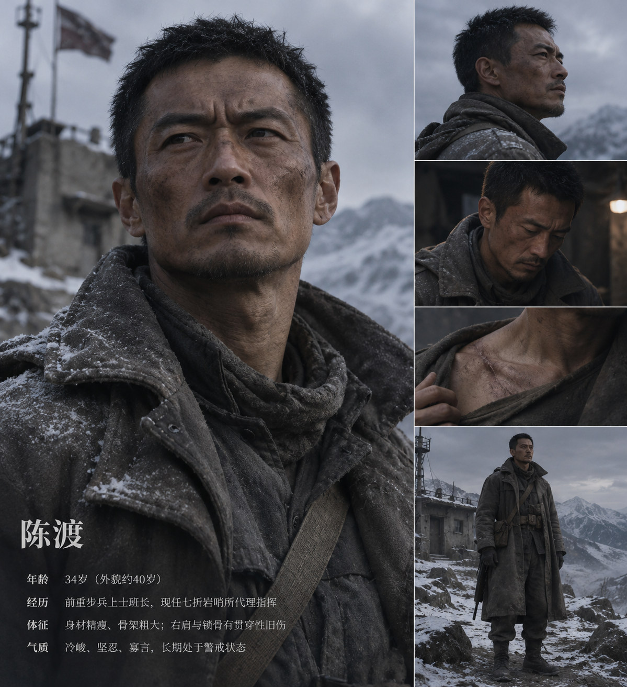

# 人物档案：陈渡（代号：老渡）

> 最后修订时间：2026-11-28 11:40:00 +08:00

## 角色图

> 本图为角色视觉参考，涉及年龄、伤病、装备及剧情事实时，以人物主档文字设定为准。

## 索引速查字段（摘要）
- **所属阵营/身份**：原弘毅重步兵上士班长，现为青隘断崖小队长；归编后受弘毅节制
- **显性性格**：寡言克制、重情护短，惯于过度担责，执拗不肯轻弃战友
- **能力特长**：险地战术指挥、交替掩护与撤离组织；地脉微颤感知伴随反噬

## 1. 基础信息
- **姓名/曾用名/代号**：陈渡 / 弘毅编制代码 07-A-309 / 代号“老渡”、“断崖一号”
- **首次登场**：第一卷/第001章
- **角色定位**：主角
- **生理年龄/外观年龄**：34 岁 / 面相饱经风霜宛如四十许人
- **出身背景**：弘毅领南境边缘劳工营遗孤，少年入伍，纯底层血肉爬上来的实干老兵
- **所属阵营与职务**：曾任弘毅领重步兵第七突击营上士班长（A级评定）；青隘联防区断崖小队长；随青隘整编重归弘毅大区前线；第四卷叛逃，经历第五至十卷跨势力求索；第十一卷加入既有栖原诸邦，第十八卷完成统一并承担统一领导责任（职衔待定）
- **外貌特征与标志性细节**：
  - 身材干瘦但骨架粗大，右肩与锁骨有一道贯穿性疤痕（老伤微陷），阴雨天右臂有隐痛；
  - 惯常穿着褪色泛白的帆布防寒领风衣，腰带挂着三枚老式卵形破片手雷和一把自磨锋利的粗脊开山刺；
  - 标志性动作：在下达关键战术动作前，习惯用粗糙拇指下意识搓磨食指关节的老茧，目光冷冽而沉静。

## 2. 人生经历与关键转折（前三阶段与跨卷三幕因果链）

### 第一阶段：挚爱战死与残疾驱逐（初次心死）
- **青梅惨死**：在弘毅领服役期间，与青梅竹马的女友宁昭（战地通讯人员）一同驻守要塞。2141年黑梁要塞血战，宁昭在通讯掩体遭炮击坍塌、被混凝土梁重创，陈渡未能救出她，宁昭在他身边牺牲。陈渡内心彻底封死，自此拒绝接纳任何人（见第009章及独立小传）；
- **强制退役**：战后陈渡重伤（右肺叶切除、锁骨神经受损），战力评级滑落，被弘毅领高层无情强制退役并剥夺安置待遇，驱逐荒原。

### 第二阶段：扎根青隘与重振斗志（重燃微光）
- **杜衡收留**：流落至青隘联防区，受到杜衡防长如长辈般的悉心照顾与平等尊重；
- **结识霍山与林霰**：在青隘结识了老一辈青隘工匠霍山、野蛮生长的猎户孤女林霰，接掌断崖小队。在青隘“守民守边、不牺牲小人物”的温暖底色下，陈渡重新振作，重拾军人斗志。

### 第三阶段：大势所迫·整体合入弘毅领
- **青隘整编入弘毅**：面对各大巨头的严峻挤压与物资封锁，杜衡防长迫于形势，率青隘联防区整体合入弘毅领，任弘毅青隘防区整编负责人并仅保留地方民防协调权。陈渡随同断崖五人小队全员齐整回归弘毅领南境序列。

### 第四阶段：二入弘毅的连环悲剧风暴（失去青隘，叛逃出境）
- **巨头出卖与弃卒炮灰**：弘毅高层自始至终将青隘大区部队当成正面消耗的诱饵炮灰予以牺牲出卖；
- **致命连环多米诺因果链**：
  1. **严恪战死与大闹军部**：阵地战中严恪力竭战死，尸审查出早年第三方暗探废旧休眠信标。面对全线战局崩溃的严酷问责，军政部门借真实存在的旧线人经历，但在缺乏本次战役通敌证据的情况下直接定罪，取消阵亡待遇并短时示众。陈渡暴怒冲入军部据理力争，将严恪染血胸甲拍在长官桌上，彻底撕破脸皮直斥高层视戍卒如草芥；
  2. **沙盘弃卒·绝命任务A**：正面主力防线面临雪崩危局，弘毅统帅部在陈渡冲撞军官之前已决定主力沿东北公路北撤保全工业核心。涉事军官借争执点名派断崖残部前往断脊岩（青隘边民疏散峡谷隘口咽喉制高点）执行任务A，谎称两小时后有装甲连梯队接防，实则作为廉价肉盾阻滞敌轻装穿插前锋掩护撤民，并隐瞒援火已被抽走且提前炸毁接应桥梁；
  3. **任务A惨败·林霰救民断后与执意封舱**：面对锐科轻装穿插部队对断脊岩疏散通道的威胁，林霰为掩护边民与队友断后，身受致命伤后短时继续射击。陈渡拼死杀回将弥留垂死的林霰抱在怀中，林霰望着他，因知道两人即将分别而落泪，始终没有表白，随后在陈渡怀中牺牲。陈渡因眼睁睁看着她离去的撕心剧痛与“是自己连累小队”的滔天负罪感而濒临精神崩溃，坚决不承认林霰阵亡，拒绝接受江小年确认的死亡事实，执意用老霍修复改装的旧军用低温保存设备封存林霰遗体，幻想寻找逆转生死的技术；这只是陈渡的主观执念而非真实医疗希望；
  4. **青隘侧翼失守·杜衡救民殉节**：弘毅提前抽撤主力，任务A失援使敌军突破部分疏散线路。青隘原有约两万居民，已有部分撤离、部分失散和遇难，绝非全员死难。杜衡在防务和粮道双重失衡下仍组织撤民、交接物资与后撤路线；他明白陈渡不是战略败局的始作俑者，向陈渡托孤杜川并留下保护幸存者的命令。最终杜衡在救民交接后重伤被围、寡不敌众，敌兵破门时举枪自尽殉国；他始终**不说脏话、不辱骂他人**。陈渡被遗弃的愤怒与对自己选择的自责加深，却不能把全部青隘沦陷直接归咎于自己。
- **决绝反叛**：严恪之屈、林霰之死、青隘之祸、杜衡之殉！环环相扣的致命重负彻底砸碎了陈渡的灵魂，他冲入战区宪兵机要物证库夺出带有官方条码封签的严恪骨灰盒，带着推车上的林霰遗体保存舱，在老霍使用现成重武器有限改装火力的掩护下突破哨卡，决绝反叛杀出铁幕！

### 第五阶段（第5—10卷）：执念求索、幻灭与正式告别
- **唯一主观动机**：他明知林霰已被江小年判定死亡，却无法接受现实，携旧军用低温**遗体保存装置**远行，寻找各大体系声称可能存在的意识与生命技术。设备只保存遗体，绝非生命维持或复活保证。
- **作者2026-11-04新求索线**：第五卷陈渡专程返丰壤矿水联运区找第三卷结识的阿七确认克隆人，见面后核查阿七出自锐科人工培育项目；**知道技术源自锐科，决定加入锐科内部调查复制人情报**（不是泛泛有偿合作）。第六卷通过受限外勤及审验／医务／研究者分级资料，查明培育体的自身原有灵魂非遗传供体、外源来自死囚或求永生者，注入后破裂融合且成功率不高、不能保证来源者还是同一人，**更不能保存/迁移遗传供体原有完整记忆和人格**，故克隆并不等于复活；杜川随后介绍严格留学准入的天衡海岛医学研究体系，陈渡经沧溟寻找特殊海运途径入岛。
- **希望最终破灭与沧溟营救**：第七至九卷逐步核实医学途径，第九卷经天衡最终医学证据确认林霰不可复活，陈渡心灰意冷。**第十卷从天衡经沧溟返回大陆时江小年被俘**，他主动决定营救小年，率队行动、亲身冒险，**为救她身受重伤**；小年获救后凭医护训练和外部专业协助长期照顾他恢复，两人在康复期间逐步明确感情，**陈渡最终接受江小年**。这既不意味着他已忘记林霰，也不是救命恩情换爱情；按原终点安葬林霰。
- **感情落点**：与江小年在双方可拒绝、可讨论的前提下互相接纳，不以救命之恩交换爱情，不将林霰的死亡变成新关系的道德障碍或讨好读者的仪式。

### 第六阶段（第11—18卷）：加入栖原、统一诸邦、给流亡者归宿
- **第十一卷入山**：带伙伴加入早已存在的栖原；通过商路核实杜衡旧部和幸存边民，自愿迁入者按当地规则安置，不返回青隘建立政权。
- **从军人到建设者**：从既有山寨基层事务做起，面对各阵营出身的居民、地方领袖及真实利益冲突；学习税粮、兵役、伤亡认定、工业、法度与外交，接受专业分工及居民异议。
- **第十六卷**：经共同危机形成跨寨防务和救援协调，获得广泛但有限授权；统一仍需各寨认可。
- **第十八卷**：统一既有栖原诸邦，承担受制度约束的统一领导责任，使各大势力夹缝中的人获得可持续归宿。世界仍为七席。终场以栖原普通哨所与七折岩呼应；具体制度与职衔待细纲确认。

## 3. 战斗能力与特长
- **编制职务与阶段职能**：
  - **核心本职**：断崖小队队长。负责全队**战场战术指挥、作战决策、任务多方协调**；
  - **开篇初始兼任**：**兼任强攻手**（在严恪尚未归队前，陈渡必须亲自持枪突前强攻、投掷破片雷破障清雷，这种高负荷强攻极大透支其右肺和右肩旧伤；待严恪加入后，卸下强攻重担专注指挥与综合侦察）。
- **特长**：高压环境下战术决策、复杂地势微地形调度、交替掩护撤退路线规划、精准步枪射击。
- **特异禀赋**：【地脉微颤直觉】（低频危险预感，代价：颅压剧痛鼻孔渗血）。

## 4. 人格与情感底层逻辑
- 坚韧冷峻、极少废话；青年因青梅宁昭战死而将心门彻底冰封；与林霰长期并肩作战，一直知道林霰喜欢自己，却因旧伤与失去宁昭的创痛不敢接受，也没有挑明；第四卷林霰重伤时他一心救人，未意识到她快要离去。她牺牲后，他才在临别的眼泪与往事中惊觉失去，逐渐崩溃；中期以林霰保存舱为执念走遍天下。
- **第十卷阶段二未来候选（与第九卷个人求医失误区分）**：在天衡设施安全检修期间，他第006章面对一次可私看他人未授权意识研究资料的捷径，强忍失去林霰复生线索的焦虑而放弃；第008章又因习惯以战时口令调度民事搬运者而被闻汐指出权责错误，须实际承担改约费用和证据清点延误。第011章不以抢档、武力和越权替代院内文控处理，通过合法见证推动有疑外联摘要暂缓；第014章亲手拿出林霰早已确认的战地死亡记录申请最终医学复核，**是愿正视证据而不是已接受她不会回来**。这些都是未写正文的阶段二候选，不抹去第九卷已有的主角失误。
- **心结分层推进，不得混为一次顿悟**：第4卷拒认林霰之死，第5—9卷逐级求索，第9卷最后证据击碎幻想，第10卷救江小年身受重伤后，依靠事实、行动与队友陪伴亲手安葬林霰、接纳江小年；第11—18卷由守一个人走向守一群人，并要接受对权力的监督。两人感情出于彼此选择而非救命债。

## 5. 禁止偏离清单（Negative Constraints）
- ❌ 绝对禁止：在未经剧情铺垫的情况下突然展现超凡战略政治斡旋才能。
- ❌ 绝对禁止：忽视肺部与肩胛旧伤，进行无代价超人式连环强攻。
- ❌ 绝对禁止：危急交火关头长篇说教或发表空泛人生哲理。
- ❌ 绝对禁止：违背对战友与边民的守边承诺向压迫强权低头。
- ❌ 绝对禁止：把救回江小年写成抛弃林霰遗体的二选一；他是把保存舱托付给队友，不是抛弃。
- ❌ 绝对禁止：将小年的获救变成她欠下的情感债；陈渡不追问受辱细节，不要求她报答。
- ❌ 绝对禁止：用顿悟台词宣布心结解开；只通过托付保存舱、递围巾、先处理小年伤口等行动表现变化。

## 第039章旧稿历史状态（旧正文已删除）（2145年3月25日）
- 3月25日重归军籍，07-A-309旧代码复核，仍受胸肺、肩与右腿件限制；步枪携20发，待次日返七折岩。

## 动态传记深化（前史及独立命运）

### 开篇前的完整人生轨迹

以下补充为本轮传记设计候选；已有黑梁、伤退、收留、组队等锚点按原设定。开篇34岁，推算约2110—2111年出生，生日不锁定。

**童年（约0—12岁）**：南境劳工营的孩子在集体生活中长大。陈渡幼时跟着成年人领粮、搬取生活物资，记得谁能领到口粮、谁因登记遗漏被拒。父母的姓名、死亡原因及具体年龄暂无证据，不追加惨案。候选：他与宁昭最早在营地公共生活中认识，宁昭愿意替不识字的人读通知，他替行动不便的邻人搬东西，两人的亲近有共同生活基础。

**少年（约13—18岁）**：为获得稳定收入与离开劳工环境的机会入伍。最初他也相信军队的规则会保护认真做事的人。候选：因识字和算数不够熟练，吃过交接记录不清的亏；此后养成把人、物和责任当面点清的习惯。宁昭有自己的通讯技术学习与工作，不依靠陈渡服役。

**基层军旅（成年至2141年）**：从听令的兵成长为能带队的班长，主要靠长期训练、执行和对同伴身体状况的判断。候选：第一次代理班长时，高估一名队友的体力，未能及时安排轮换，造成任务延迟与伤情加重；他承认判断有误，但由此发展出凡事亲自承担、很难放心交给别人的倾向。与宁昭商量过退役后的普通生活，具体地点和婚姻安排留空；韩铮旧交只保留有限照应，不认定同一战位。

**2141—2143年**：黑梁伤退后，他失去收入、编制和原有生活计划。杜衡的收留给了他恢复与重新谋生的条件。候选：恢复期间尝试教民兵基础纪律、清点民防物资，最初因旧伤不得不请别人替班；逐渐发现保护居民并不只靠前线勇敢。2143年接掌小队，霍山的维修与林霰的独立判断都成为他能够继续工作的条件。

**2145年2月18日开篇状态**：有稳定岗位和可托付的战友，仍回避长期私人承诺；对军令的信任已破裂，却尚未形成离开军事身份的治理理想。日常欲望是把哨守完、让三人吃上热饭、能按时回家。未解决的矛盾：保护人与过度代替别人选择之间的冲突。

### 后续独立选择与检验
- 卷2—4：面对救人、服从与资源约束逐次作出选择；不能把林霰主动断后和战略北撤全算在自己头上。
- 卷5—10：复生执念与他人生命发生冲突；每次证据失败必须留下现实代价，最终选择营救活人并接受终判。
- 卷11—18：候选考验为熟悉的战友违反公开分配规则时，是否允许独立岗位裁决；从亲力亲为学会交付责任，终局仍受制度约束。具体制度和场景待卷章核定。

## 人格矛盾与成长弧线（本轮确认方向）

**核心矛盾（作者确认方向）**：重情护短、过度担责与控制欲同源。害怕再失去亲人，使陈渡倾向于以保护为理由代替他人决定；越重视的人越难放手。他对熟人的偏袒可能伤害陌生人。童年缺乏保障、黑梁失去宁昭与伤退解释这一性格，不免除责任。独立生活愿望仍是守完哨、让人安全回家。

**成长与代价（场景候选）**：第一至三卷在林霰坚持独立判断时，他可能越过合理指挥边界，因不肯授权导致队友另担风险，必须听取异议；第四卷保留北撤先于顶撞、林霰自主断后，不把战略失败归罪于他。第五至九卷围绕遗体保存开支、行程与活人治疗，他可能明知有更公平的用途仍要求优先保障自己的求索，队友明确拒绝；使队伍付出物资、收入或信任代价，不篡改既有医疗结论。第十卷接受江小年并安葬林霰并非一次性治愈控制欲。第十一至十八卷，他可能优先安置青隘旧人，或给亲信例外，引发邱守成及居民异议；必须纠正具体不公、承担损失、允许独立裁决和拒绝，而非只作口头检讨。终局由掌权后是否仍接受规则检验成长。

## 表里反差与成长惯性（深化候选）

对外沉着可靠、愿意挡风险；内心害怕再次成为无用的人，习惯以亲自承担证明价值。保护别人有时也为了使自己安心。候选：过度替队友做决定、对保存林霰遗体的资源开支自我合理化、优先青隘旧部，构成同一人格惯性。面对江小年、阿七、邱守成的拒绝，承担实际代价，而非每次由旁白解释。终局仍可犯错但接受独立纠正，不改锁定结局。

## 修订记录

- 2026-11-28 11:40:00 +08:00｜作者要求深化群像表里反差及不得已选择；补足人格惯性与跨卷关系代价，具体事件为候选；保留已锁定结局，待章纲核验。
