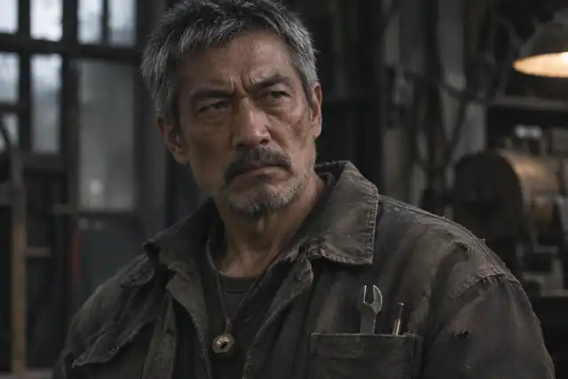

# 人物档案：霍山（代号：螺栓）

最后修订时间：2026-11-28 11:40:00 +08:00

## 角色图

> 本图为角色视觉参考：短花白发、外观近六十岁的东亚男性，工装上仅露一两件工具。人物生理年龄及剧情事实以人物主档为准。

## 索引速查字段（摘要）
- **所属阵营/身份**：青隘本地修械工，断崖小队机械、后勤与通信骨干
- **显性性格**：暴躁碎嘴、惜物护短，嘴硬心软，待年轻队员如家人
- **能力特长**：野战维修、装备改装、通信保障与抢修；始终受材料和工况约束

## 1. 基础信息
- **姓名/代号**：霍山 / 代号“螺栓”、“老霍”
- **首次登场**：第一卷/第001章
- **角色定位**：主角（断崖小队群像核心主角 / 首席机械维修师与重火力支柱）
- **生理年龄/外观年龄**：48 岁 / 外观近六十，短发花白凌乱，两颊深陷，胡茬浓密，眼神常带苍凉但极专注
- **出身背景**：**土生土长的老一辈青隘人**。祖辈便在这片大峡谷依靠修理机械、铁匠打铁为生
- **所属阵营与职务**：青隘联防区“断崖小队”首席机械维修师、后勤装备支柱（**开篇初始三人编制骨干**）
- **外貌特征与标志性细节**：
  - 身着一件油渍斑斑、口袋密布的重帆布工兵马甲，腰侧挂着特制多功能工具钳、自制焊枪与几枚备用六角螺母；
  - 双臂健全；双手手掌布满烫伤印与机油渗入指纹的黑痕，右手中指由于工伤缺失半截指甲；
  - 标志性动作：思考机械故障时，喜欢下意识转动套在小指上的黄铜螺母，嘴里嚼着苦涩的防风草叶；看到陈渡或林霰挨冻时，会粗暴地把热水壶或烤热的铁板塞过去。

## 2. 人生经历与至痛创伤（如父的情感根基）
- **青隘土著与匠人本色**：
  - 霍山是土生土长的青隘土著，祖祖辈辈都在青隘大峡谷当铁匠和修械工，靠着一手修补粗钢、打磨轴承与淬火锻件的本事糊口。在这片风蚀绝壁上，他曾经也有过一个虽苦却热气腾腾的四口之家。
- **长子病骨与耗尽家财（至痛前篇）**：
  - 霍山早年育有一儿一女。长子成年前后在青隘险恶的矿区做工，不幸患上恶性重病（地脉粉尘诱发的重度矿毒衰竭与肺坏疽）。
  - 为了给长子治病延命，霍山掏空了祖上和自己数十年来积攒下的所有积蓄，变卖了祖传的精钢打铁炉、积攒的稀有零件与家中一切值钱物什，四处低声下气借债求医、在黑市高价收购抗生素与活性抑制剂。
  - 治疗仍未见起色，家中欠下沉重药债。此时长子尚在世，霍山把救活他当成最迫切的目标，开始考虑以女儿的高风险军职换取治疗费用。
- **女儿入险队与绝域失踪（至痛中篇）**：
  - 霍山主动劝说并安排小女儿加入青隘前沿先锋队，利用高额预支津贴给长子继续治病。没有暴力强逼，但他作为父亲的权威、偏向儿子的急切与家庭困境共同压缩了女儿的选择。她答应参军，也爱哥哥，却觉得父亲把自己的安危放在了哥哥之后，由此生怨。
  - 女儿开拔前，预支的安家津贴被用于长兄治疗。父女曾有还清债后重新起炉打铁的约定；旧约成为她对家与父亲的复杂记忆，不能写成她主动为家庭牺牲的宣言。
  - 然而开拔深入危险地脉不久，小女儿所在的先锋小队遭遇强敌越界伏击与地质塌方，整队被打散失联，小女儿自此“不知所踪”。她实际被栖原人救起，带着对父亲的怨恨选择留在那里。长子最终仍不治身亡。
- **三年苦等与冰冷抚恤（至痛终篇）**：
  - 儿子没能救活，自己又曾亲手把女儿推向险境。霍山既思念女儿，也长期背负对当年偏心选择的愧疚。在往后的整整三年里，霍山一边在修械厂没日没夜地敲铁修车，一边近乎疯魔地向每一支回防的巡逻队、斥候打听先锋队失踪士兵的消息，死死抓着一丝一毫哪怕虚无缥缈的念想，深信女儿像野草一样命硬、还活着在某个岩缝深处等他接回家。
  - 整整煎熬了三年，前线没有传来任何生还踪迹。三年后，青隘联防区军务处根据战时失踪条例，正式出具公文将小女儿认定为“阵亡”。
  - 霍山被叫去军务处，领回了一枚冰冷变形的名牌、一张泛黄的阵亡通告，以及一笔薄薄的抚恤金。那一刻老霍没有嚎啕大哭，只是指节泛白地攥着抚恤金袋子，掌心鲜血淋漓。长子没救活，小女儿拿命换来的抚恤金他一分钱都舍不得花，缝在工兵马甲最内层的贴心口袋里，如同烧红的烙铁时刻灼烫着他的心口。
- **情感转移与新生寄托（如父的深沉根基）**：
  - 这段刻骨铭心的经历重塑了霍山的整个人格：看似暴躁抠门、惜弹如命（连一枚旧螺丝、半截焊条都要捡回兜里），实则是极度害怕失去的创伤应激；
  - 杜衡防长将背负青梅战死情伤、习惯透支肉体的陈渡，以及失去双亲、在风雪绝壁上野蛮长大的孤女林霰编入断崖小队后，老霍在陈渡身上看到了当年病榻上隐忍刚烈的长子影子，在林霰沉默寡言、倔强要强、端起重狙连命都不要的野劲里，看到了当年自己劝进先锋队的小女儿；
  - **霍山暗自将陈渡和林霰当成自己亲生儿女来看待与呵护**，嘴上天天骂骂咧咧，背地里却把唯一的干粮、烤热的铁板和自制的暖身油全留给两个年轻人。他把对一双儿女所有的愧疚、亏欠与血泪深情，化为对这两个年轻人的暗中守护和补偿心理。他的关爱真实存在，但不能抵消当年对亲女儿的亏欠。

- **第四卷林霰牺牲后的反应（正文与后续规划约束）**：刚失去视如亲女的林霰时，霍山的悲痛与陈渡同样深重，允许他当场失态；在小年提醒和撤离压力下，他比陈渡稍快重新承担具体事务，但并非已经走出悲伤。

## 3. 战斗能力与特长
- **编制职务与阶段职能**：
  - **核心本职**：机械装备维护、故障诊断、通信与无人机操控；
  - **开篇初始兼任**：战斗救护（老工兵粗暴包扎，骂骂咧咧“修铁的手缝人肉”，直至江小年入队移交）；
  - **后期战略职能**：**第五至十卷小队流亡装备维修负责人、第十一卷起栖原工程与装备体系的重要建设者；第十五卷终局依人物规划**。

## 4. 特异禀赋与机械能力边界
- **前期初始禀赋【金属裂隙触音】**：
  - 接触或检修机械时，能凭借长期经验与增强的触觉感知金属应力、细微振动和加工状态，辅助判断疲劳、裂纹或故障；不替代仪表、检测工具和实际检修。
- **能力边界与后期工作**：
  - 林霰牺牲不会令霍山获得新能力或制造能力跃迁。极端悲痛影响他的情绪和选择，不改变世界观设定的禀赋范围。
  - 第四卷第128章旧规划可表现他察觉金属应力异常并调整搬运方式，属于既有感知与经验的运用，不称为觉醒或重构。
  - 抢修旧军用遗体保存模块时，只能使用库存设备、可用备件、工具、时间与能源；不得凭空制造维生系统或恢复生命。
  - 后期参与维修体系、工匠培训和已有设备改造，均受材料、机床、技术、能源与团队条件限制；不能单人凭空制造重火器或压倒大势力的火力。

## 5. 人格与情感底层逻辑
- **外显性格**：看似暴躁抠门、惜弹如命、嘴硬心软，常埋怨林霰寡言、不肯照顾自己，但暗地里连夜手工给林霰磨狙击枪备用撞针；
- **隐秘私生活与习惯**：重帆布工兵马甲最内层心口处，缝着一个用油纸死死包好的暗袋，里面装着用红绳系着的小女儿阵亡金属狗牌、折叠发脆的阵亡通告，以及当年领回的那笔薄薄的抚恤金（平时绝对严禁任何人碰他的内口袋）；
- **核心动机**：“老天爷夺走我一双儿女，又把这两个苦命孩子送到我跟前。谁动我的孩子，我就用亲手造的枪炮崩了谁！”

## 6. 终局命运与边界
- **后期事业**：在栖原主持军械工程，培养工匠，留下可由后继者维持的标准化生产和后勤维修体系。
- **终局命运（第十五卷规划）**：第十五卷，她为医药转运与陈渡所在接收点接洽，确认霍山仍活着且重伤垂危，经过挣扎自主决定见他，先递口信再赶来。霍山原选止痛，收到口信后主动重新了解并接受治疗。父女相处数日，霍山承认当年把救儿子的愿望置于女儿的安全和选择之前，向她道歉，不要求原谅；女儿表达多年怨恨与伤害，理解他的困境并逐渐释然、与他和解，仍保有对当年决定的否定。名牌、抚恤袋与起炉旧约在重逢中回收；霍山随后因伤去世，她继续独立推进山地转运。具体伤因、章位与对白待定。

## 7. 禁止偏离清单（Negative Constraints）
- ❌ 绝对禁止：将霍山写成冷血唯利是图的黑市军火贩子。
- ❌ 绝对禁止：把林霰之死写成霍山获得新造物能力的触发点；其机械直觉只增强应力感知和加工判断，维修改造仍受物料与设备限制。
- ❌ 绝对禁止：对陈渡和林霰的生死危险漠不关心。

## 第039章旧稿历史状态（旧正文已删除）（2145年3月25日）
- 续批缸套和水箱修复料到后在老营工位修复山獾号，复试后仅有限运输减载；近防霰弹4发。

## 动态传记深化（前史及独立命运）

### 开篇前的完整人生轨迹

新增家庭日常为候选；48岁对应约2096—2097年出生。妻子的现状、两个孩子的姓名和出生年份、女儿失踪确切年月尚未确定；三年等待的锚点保留，不硬定在某年。

**童年与学徒（约0—17岁）**：霍山成长于峡谷修械家庭，早年替长辈整理废料、清扫炉边、观察工序，逐步能承担小修。候选：第一次独立交付的器件返工，他被要求自己解释错误、承担补修的时间；由此形成对质量较真、宁愿返工不肯糊弄的脾气。初次热爱工艺与养家愿望先于家庭悲剧。

**青年与成家**：候选：靠修农具、炉具、车辆及公共设备逐步攒出自己的工具；和家人分担家计，家里有一张固定记工账，工具不外借但愿意替人修。曾经愿意教孩子手艺，儿女有自己的志向。伴侣身份和去向待核，不能凭四口之家擅设另一场死亡。

**中年（长子患病之前）**：矿区及商路需求带来收入，也让家庭依赖不稳定的劳动。候选：曾因为赶交货忽略孩子的休息请求，事后认识到手艺不能替家人决定生活；儿子仍有自己的工作选择。长子患病后卖炉筹药，霍山为继续救儿子劝说并安排女儿入先锋队，女儿在压力下答应；遇袭后女儿留栖原，长子病逝，三年等待与抚恤照旧。家庭债务、技艺和制度保障的缺口共同造成失去，贫困解释他的处境，但不能免除他偏心和替女儿安排人生的责任。

**2143—2145年**：加入断崖小队，修械能力成为重新进入共同生活的途径。候选：初期仍在夜里整理女儿名牌，白天对物资极度节省，偶尔因过度节省影响队友舒适；经队友提醒学会分辨能省和不能省的东西。对陈渡与林霰的父辈关怀不抹掉他们的自主性。

**开篇状态**：仍思念家人，维持日常工作；希望队友安全，也希望修过的机器有人继续使用。独立矛盾为爱惜物与爱惜人、替孩子安排与尊重他们决定的张力。

### 后续独立选择与检验
第四卷悲痛中承担保存设备维修；中期在能源、工况约束下协调队伍。入栖原后候选：有学徒提出与他不同的合格工艺，他能否认可并放手。第十五卷治疗选择因女儿口信重新评估，父女重逢、坦诚旧怨并逐渐和解后死亡；妻子去向与工坊接班人待核，不新增超能力。

## 表里反差与成长惯性（深化候选）

对外粗鲁抠门、爱抱怨；内在既有真实慈爱，也有当年偏心后的补偿欲。可能因为怕重复错误而反向过度保护林霰、陈渡，替他们做决定；得知女儿不归出于主动选择时，可先感到受伤，再面对自己的责任。女儿入军、扎根栖原、父女和解、霍山去世保持，具体对白待审；关爱不是赎清过去的凭证。

## 修订记录

- 2026-11-28 11:40:00 +08:00｜作者要求深化群像表里反差及不得已选择；补足人格惯性与跨卷关系代价，具体事件为候选；保留已锁定结局，待章纲核验。
